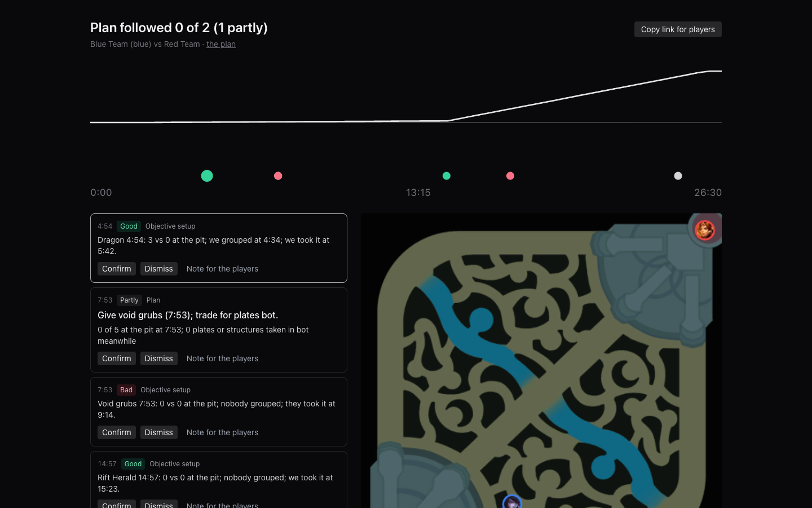
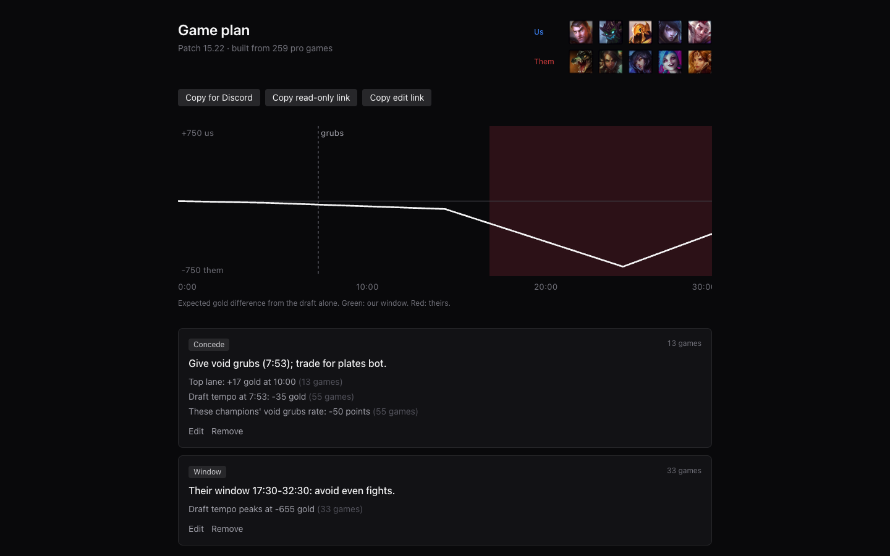

# Throughline

Did we play our draft?
Throughline turns a finished League of Legends draft into a short, checkable game plan, then reviews the game that was played against it, with a replay clip for every verdict.



Built for the Cloud9 x JetBrains "Sky's the Limit" hackathon, Category 2 (League of Legends).

## What it does

**Plan.**
Enter a finished draft, or open a pro game to prefill it.
Throughline builds a plan of 4 to 8 checkable items, such as "contest first dragon with 3+ near the pit by 4:40" or "avoid even fights in their window".
Every item shows its evidence and the number of games behind it.
The coach can edit, remove or add items, and export the plan to Discord as a checklist.



**Review.**
Pick the game that was played.
Each plan item gets a verdict (followed, partly, not followed, not applicable) with the numbers it read and a replay clip of the deciding moment.
Five kinds of macro moments the plan did not cover are detected from the game alone.
The coach confirms or dismisses each entry, adds a note, and shares a read-only link with the players.

Nothing in the app is written by a language model.
Every line is a template filled from counted data, with its sample size.

## Try it

Hosted demo (synthetic league, no login): [Hosted demo URL]

Demo video (under 3 minutes): [YouTube demo URL]

### Locally, with the synthetic league

No GRID data is needed.
The synthetic league runs the whole app.

```bash
cd backend
uv sync
uv run throughline seed
uv run throughline build --offline
uv run uvicorn throughline.api.main:app --reload
```

In a second terminal:

```bash
cd frontend
npm install
npm run dev
```

### Locally, with the GRID starter data

Clone the hackathon's starter repository (sparse, `lol/` and `meta/` only) next to this repository, so that it sits at `../stl-hackathon-2026-grid-starter`, or point `STL_DATA_DIR` at it.
Then:

```bash
cd backend
uv run throughline ingest
uv run throughline build
uv run throughline validate --holdout-from 2025-08-20
```

Ingest reads the starter data in place and never copies it into this repository.
Run the API and the frontend as above.

### Tests

```bash
cd backend && uv run pytest              # 89 tests; add -m realdata with the starter data
cd frontend && npm test                  # 13 Vitest tests
cd frontend && npm run e2e               # 2 Playwright tests
```

## How it works

```
ingest CLI
  ├─ lol/series.csv: every series, oldest first
  ├─ per series: stream the .jsonl.zst, split it into games
  └─ per game: infer roles, then compact tables
        games, participants, frames, kills, spawns,
        objectives, structures, plates, items
build CLI
  ├─ knowledge base per patch window (curves, matchups, spikes, objective tendencies, spawn times)
  ├─ per game: fights, objective setups, moments
  └─ validation: plans from prior games, checks, adherence tables
API
  ├─ plan: knowledge base lookups and generator (milliseconds)
  └─ review: per-game features and checkers (under a second; cached)
```

Analytics live in DuckDB, rebuilt by the CLIs.
The app's own records (plans, reviews, confirmations, notes) live in SQLite.
The full method, constants and validation results are in [docs/methodology.md](docs/methodology.md).

## Built with JetBrains

PyCharm for the backend, WebStorm for the frontend, DataGrip for the DuckDB and SQLite files, and Junie as the main coding agent.
The project guidelines are in [.junie/AGENTS.md](.junie/AGENTS.md), the task-by-task history is in [docs/BUILD_LOG.md](docs/BUILD_LOG.md), and the write-up is in [AI_SHOWCASE.md](AI_SHOWCASE.md).

## Data

The analysis uses the hackathon's official GRID starter data.
It is not in this repository, and its license limits it to the hackathon.
Nothing built from it is committed.
Champion icons and the minimap come from Riot's Data Dragon.
There are no team logos anywhere in the app.

## License

Throughline is released under the AGPL-3.0, see [LICENSE](LICENSE).

Throughline isn't endorsed by Riot Games and doesn't reflect the views or opinions of Riot Games or anyone officially involved in producing or managing Riot Games properties. Riot Games, and all associated properties are trademarks or registered trademarks of Riot Games, Inc.
